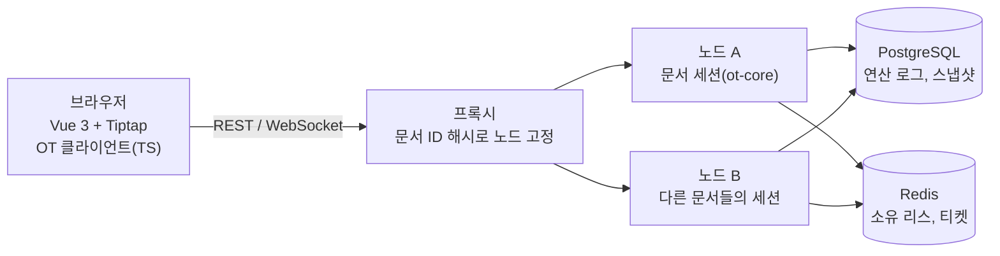

# CoPage

**여러 사람이 한 페이지를 동시에 고쳐도 모두 같은 결과를 보는 블록 기반 문서 서비스** (노션과 비슷한 편집기 + 구글 문서식 동시 편집)

동시 편집 충돌은 라이브러리(Yjs 등)를 쓰지 않고 **서버 주도 OT(Operational Transformation)를 Java 로 직접 구현**해서 푼다.

▶ 시연 영상: [docs/demo/copage-demo.mp4](docs/demo/copage-demo.mp4)

| 구분 | 기술 |
| --- | --- |
| 백엔드 | Java 25, Spring Boot 4.2, Spring Security 7.2, WebSocket(STOMP 없이 직접) |
| 프론트엔드 | Vue 3, Vite, Pinia, Tiptap 3(ProseMirror) |
| 저장소 | PostgreSQL 17(연산 로그, 스냅샷, pg_trgm 검색), Redis 7(소유 리스, 티켓, 토큰) |
| 시험과 운영 | JUnit, Testcontainers, Toxiproxy, ArchUnit, Vitest, Playwright, Prometheus 지표, GitHub Actions |

## 이 프로젝트로 보여 주려는 것

1. **동시성 충돌을 락이나 덮어쓰기가 아니라 연산 변환으로 해결한다.** 같은 문단을 두 명이 고치고, 한 명이 Enter 로 블록을 나누는 순간 다른 사람이 그 블록에 글자를 쳐도 모두 같은 문서로 수렴한다.
2. **메모리에 상태를 든 서버를 여러 대로 늘린다.** 한 문서는 한 노드가 맡고(소유 리스), 프록시가 문서 ID 해시로 같은 노드에 보낸다.
3. **로그 기반 저장과 복구.** 모든 편집을 연산 로그로 남기고 스냅샷과 합쳐 과거 시점을 열고 복원한다.
4. **끊긴 연결에서도 깨지지 않는 정합성.** 오프라인 편집, 멱등 재전송, 재접속 동기화로 확정된 편집을 하나도 잃지 않는다.

## 주요 기능

- **편집기**: 블록 10종(문단, 제목 1~3, 글머리, 번호, 할 일, 토글, 인용, 콜아웃, 코드, 구분선), 글자 서식, 마크다운 단축 입력, 슬래시 메뉴, 블록 끌어 옮기기, 마크다운 붙여넣기
- **실시간 협업**: 동시 편집, 다른 사람의 커서와 접속자 목록, 내 편집만 되돌리기, 연결 상태 표시, 오프라인 편집(브라우저를 닫아도 IndexedDB 에 남음)
- **워크스페이스**: 페이지 트리(끌어 옮기기, 휴지통 30일), 사이드바 실시간 반영, 즐겨찾기와 최근 본 페이지
- **공유와 권한**: 전체 권한/편집/댓글/읽기 4단계, 하위 페이지 상속과 제한, 초대 링크와 공유 링크. 권한을 회수하면 열린 편집기에도 1초 안에 적용
- **버전 기록, 댓글, 검색**: 과거 시점 보기와 복원(복원도 되돌릴 수 있음), 글자에 붙는 댓글, 멘션과 알림(SSE), 두 글자 한글 검색
- **계정**: 이메일 가입, JWT + Refresh 토큰 회전, 구글과 깃허브 로그인

기획서의 기능 요구사항(P0, P1, P2)은 모두 만들었다. 실제 AWS 서버에 올리는 일만 남았다(구성과 절차는 [docs/DEPLOY.md](docs/DEPLOY.md)). 단계별 상태는 [docs/12-ROADMAP.md](docs/12-ROADMAP.md) 14.1.1 에 있다.

## 실행하기

JDK 25, Docker, Node.js 22.12 이상이 필요하다.

```bash
# 1. PostgreSQL(5432), Redis(6379)
docker compose up -d

# 2. 서버 (API 와 WebSocket 8080, 지표와 상태 확인은 127.0.0.1:8081)
./gradlew :app:bootRun --args='--spring.profiles.active=dev'

# 3. 다른 터미널에서 화면
cd frontend
npm ci
npm run dev
```

1. http://localhost:5173 에서 가입하고 워크스페이스와 페이지를 만든다.
2. 다른 브라우저(또는 시크릿 창)에서 두 번째 사용자로 가입한다.
3. 첫 사용자가 멤버 화면에서 그 사용자를 넣거나 공유 창에서 권한을 주면 같은 페이지를 같이 편집할 수 있다.

<details>
<summary>환경 변수</summary>

| 환경 변수 | 기본값 | 뜻 |
| --- | --- | --- |
| `COPAGE_DB_PORT`, `COPAGE_REDIS_PORT` | 5432, 6379 | 포트가 겹치면 `docker compose` 와 서버 두 곳에 같은 값을 준다 |
| `COPAGE_JWT_SECRET` | dev 프로필만 개발용 키 | 32바이트 이상. dev 가 아닌 프로필에서는 없으면 서버가 뜨지 않는다 |
| `COPAGE_MANAGEMENT_PORT`, `COPAGE_MANAGEMENT_ADDRESS` | 8081, 127.0.0.1 | 지표(`/actuator/prometheus`)와 상태 확인 |
| `COPAGE_GOOGLE_CLIENT_ID`, `COPAGE_GITHUB_CLIENT_ID` 등 | 없음 | 소셜 로그인. 없으면 그 버튼만 동작하지 않는다 |
| `SPRING_MAIL_HOST` 등, `COPAGE_MAIL_FROM` | 없음 | 초대 메일. 없으면 메일 없이 초대 링크만 쓴다 |
| `COPAGE_BACKEND` | `http://localhost:8080` | Vite 개발 서버가 `/api`, `/ws` 를 넘길 곳 |

</details>

### 여러 노드로 띄우기

노드 2대 + nginx(문서 ID 해시) 구성이다. 프록시는 http://localhost:8088 이다.

```bash
./gradlew :app:bootJar
docker compose -f deploy/cluster/compose.yaml up -d --build postgres redis node1 node2 proxy
docker compose -f deploy/cluster/compose.yaml up -d node3   # 노드 추가 실험
```

### 시험

```bash
./gradlew build                                   # Java 전체. Testcontainers 로 PostgreSQL, Redis, Toxiproxy 를 띄운다
./gradlew :ot-core:test --rerun-tasks -Dcopage.ot.scale=100   # OT 무작위 시험을 100배로 (CI 는 10배)

./gradlew :ot-core:exportVectors                  # Java 와 TypeScript 구현을 맞춰 보는 적합성 벡터
cd frontend && npm test                           # Vitest (벡터 비교 포함)

docker compose up -d && ./gradlew :app:bootJar
cd frontend && npx playwright install chromium && npm run e2e   # 브라우저 두 개로 동시 편집하는 e2e
```

### 부하 측정

```bash
java -Xmx1g -jar app/build/libs/app-0.1.0-SNAPSHOT.jar --spring.profiles.active=dev &
./gradlew :loadgen:run --args="scenario=one-doc editors=50 seconds=60"
./gradlew :loadgen:run --args="scenario=many-docs docs=500 editors=4 seconds=60 rate=1"
```

시험 목록 전체는 [docs/11-TEST-PLAN.md](docs/11-TEST-PLAN.md), API 직접 호출 예시는 [docs/09-API.md](docs/09-API.md), 운영 배포는 [docs/DEPLOY.md](docs/DEPLOY.md), 에러 모니터링(ErrDeck) 연결은 [docs/ERRDECK.md](docs/ERRDECK.md) 에 있다.

## 구조



| 모듈 | 내용 |
| --- | --- |
| `ot-core` | 문서 모델과 연산 7종의 적용, 변환, 합성, 역연산. 스프링도 외부 라이브러리도 모르는 순수 Java |
| `app` | 서버. 계정, 워크스페이스, 권한, 협업(문서 세션, WebSocket), 버전 기록, 댓글, 알림, 검색 모듈을 한 애플리케이션 안에 둔 모듈형 단일 서버 |
| `frontend` | Vue 3 화면. `src/collab/` 에 TypeScript 로 옮긴 OT 코어, 상태 기계, 편집기 어댑터가 있다 |
| `loadgen` | 부하 도구. `ot-core` 의 클라이언트 상태 기계로 가상 편집자를 실제 서버에 붙인다 |

## 신경 쓴 부분

### 1. OT 를 직접 구현하고, 맞는지 증명했다

- **블록은 ID 로 가리키고, 블록 안의 글자만 텍스트 OT 를 쓴다**([ADR 0002](docs/adr/0002-id-addressed-blocks.md)). 문서 전체를 경로 기반 JSON OT 로 다루면 변환 규칙이 폭발하기 때문이다. 연산은 7종으로 줄였다.
- **무작위 시험으로 수렴을 확인한다.** 무작위 문서와 연산 두 묶음을 어느 순서로 적용해도 같은 결과가 나오는지(TP1) CI 에서 100만 쌍, 서버 하나와 클라이언트 2~5개를 가짜 네트워크로 잇고 지연, 끊김, 재접속을 섞는 수렴 시뮬레이션을 15,000회 돌린다. 실패하면 시드를 출력해 그대로 재현한다.
- **Java 와 TypeScript 두 구현을 적합성 벡터로 묶었다**([ADR 0009](docs/adr/0009-two-implementations-with-vectors.md)). Java 가 만든 입력과 기대 결과 14,600건을 TypeScript 구현이 똑같이 계산하는지 Vitest 가 비교한다. 서버와 브라우저의 규칙이 한 글자라도 어긋나면 CI 가 멈춘다.
- **변환으로 풀면 의도가 깨지는 구조 충돌은 거부(nack)한다**([ADR 0012](docs/adr/0012-nack-on-structural-conflict.md)). 대신 거부된 묶음에서도 다른 블록의 글은 살리고, 못 살린 글은 보관함에 보여 줘 사용자 입력이 조용히 사라지지 않게 했다([ADR 0017](docs/adr/0017-salvage-rejected-edits-per-block.md)).
- **한글 조합 입력**: 조합 중에 다른 사람의 편집이 들어와도 조합이 깨지지 않는지 e2e 에서 Chrome DevTools Protocol 로 입력기를 흉내 내 확인한다.

### 2. 확정된 편집은 절대 잃지 않는다

- **ack 를 보내기 전에 DB 에 커밋한다**([ADR 0005](docs/adr/0005-commit-before-ack.md)). 메모리에만 두면 빠르지만 노드가 죽으면 "저장됨" 을 본 편집이 사라진다. 대신 여러 연결의 편집을 묶어 INSERT 문 하나로 커밋해(DB 왕복 한 번) 처리량을 지켰다([ADR 0016](docs/adr/0016-per-connection-seq-and-single-insert.md)).
- **연결마다 순번을 붙여 재전송을 멱등하게 했다.** 끊겼다 다시 붙어 같은 편집을 또 보내도 한 번만 확정된다. 보내지 못한 편집은 IndexedDB 에 남아 탭을 닫았다 열어도 다시 보낸다.
- **노드를 `kill -9` 하는 실험에서 확정된 연산 유실 0건**, 끊김부터 편집 재개까지 p99 6.3초 이하([docs/CHAOS.md](docs/CHAOS.md)).

### 3. 상태를 가진 서버를 여러 대로

- **한 문서는 한 노드가 맡는다**([ADR 0004](docs/adr/0004-single-owner-node.md)). 모든 노드가 편집을 받고 서로 방송하는 방식은 순서를 맞추기 어렵다. 문서 세션 안에서는 직렬 큐로 한 번에 하나씩 처리해 락이 필요 없다.
- **소유권은 Redis 리스, 정합성은 DB 기본 키**([ADR 0013](docs/adr/0013-primary-key-as-fence.md)). 멈췄다 깨어난 옛 소유 노드가 쓰려 해도 `doc_ops (doc_id, rev)` 기본 키 충돌로 실패한다. 펜싱 토큰을 모든 쓰기에 싣지 않고도 두 노드가 같은 리비전을 쓰는 일을 막는다.
- 계획된 종료와 노드 추가 때는 남은 편집을 커밋하고 스냅샷을 남긴 뒤 넘긴다. 노드 강제 종료, 일시 정지, 추가를 노드 2~3대로 실험했다.

### 4. 권한과 보안

- **권한은 연결할 때 한 번이 아니라 연산마다 검사한다.** 읽기 권한 사용자가 WebSocket 으로 편집 연산을 보내면 서버가 거부하고, 댓글 권한은 댓글 서식만 바꿀 수 있다.
- **권한은 캐시하지 않고 요청마다 재귀 CTE 로 계산한다**([ADR 0015](docs/adr/0015-permission-per-request-without-cache.md)). 캐시 무효화 버그로 회수된 사람이 계속 보는 일을 없앤다. 회수하면 다른 노드에 열린 편집기에도 1초 안에 적용된다.
- **Redis 장애 때는 막는다(fail-closed, 503)**([ADR 0014](docs/adr/0014-fail-closed-on-redis-outage.md)). 토큰 차단 목록을 확인할 수 없으면 로그아웃한 토큰을 통과시키지 않는다. 이미 열린 편집은 계속된다.
- Refresh 토큰 회전과 재사용 감지(재사용되면 모든 세션 끊기), WebSocket 은 30초짜리 1회용 티켓으로 연결, Origin 검사, 가입과 로그인 빈도 제한, 접근 로그의 티켓과 토큰 가리기.

### 5. 측정하고, 진단하고, 고쳤다

- **목표를 숫자로 정하고 실측을 채웠다**(노트북 기준, [docs/01-PLAN.md](docs/01-PLAN.md) 1.4).

  | 지표 | 목표 | 실측 |
  | --- | --- | --- |
  | 한 문서 50명 동시 편집, ack p99 | 150ms | 9.1ms |
  | 다른 사람 화면 반영 p99 | 250ms | 9.3ms |
  | 블록 2,000개 문서 열기 p95 | 500ms | 25.5ms (세션이 내려간 뒤 첫 열기 93ms) |
  | 노드 1대 수용량 | 문서 500, 연결 2,000 | 힙 1GB 에서 통과, 정점 힙 437MB |

- **아키텍처, 보안, 데이터 정합성, 성능을 스스로 진단하고 하나씩 고쳤다**([docs/review/](docs/review/)). 예: 2코어 4GB 로 묶은 환경에서 백그라운드 DB 쓰기가 커밋 경로의 연결을 빼앗아 ack p99 가 1.1초까지 튀던 것을 찾아 75ms 로 낮췄다(D-51).
- **장애 실험**: PostgreSQL, Redis 중단, DB 지연, 느린 클라이언트, 재접속 몰림을 Testcontainers 와 Toxiproxy 로 자동화했다.
- **모듈 경계는 ArchUnit 시험으로 지킨다**([ADR 0018](docs/adr/0018-module-boundaries-with-archunit.md)). MSA 대신 모듈형 단일 서버를 골랐고([ADR 0008](docs/adr/0008-modular-monolith.md)), 모듈끼리는 공개 인터페이스로만 주고받는다.

### 6. 결정을 기록으로 남겼다

굵직한 결정 18개는 버린 대안과 함께 [ADR](docs/adr/README.md) 로, 작업 중 내린 결정은 [DECISIONS](docs/review/DECISIONS.md)(D-01~) 로 남겼다. "왜 CRDT 가 아니라 OT 인가", "왜 STOMP 를 안 썼나", "왜 Elasticsearch 대신 PostgreSQL 검색인가" 같은 질문의 답이 거기 있다.

## 문서

| 문서 | 내용 |
| --- | --- |
| [01-PLAN](docs/01-PLAN.md) | 목표, 기능 요구사항, 성공 기준과 실측값 |
| [03-ARCHITECTURE](docs/03-ARCHITECTURE.md) | 모듈, 문서 세션, 노드 고정 라우팅, 저장소 장애 |
| [04-OT-DESIGN](docs/04-OT-DESIGN.md) | 블록 모델, 연산 7종, 변환 규칙 |
| [05-PROTOCOL](docs/05-PROTOCOL.md) | WebSocket 메시지, 종료 코드, 재접속 |
| [07-SECURITY](docs/07-SECURITY.md) | 토큰, 권한 모델, 연산 단위 인가 |
| [11-TEST-PLAN](docs/11-TEST-PLAN.md) | 시험 목록, 장애 실험, 부하 시나리오 |
| [12-ROADMAP](docs/12-ROADMAP.md) | 단계별 일정과 지금 상태 |
| [docs/README](docs/README.md) | 전체 문서 목록 |

## 작업 방식

1. 이슈를 먼저 만든다.
2. `develop` 에서 `feature/번호-작업이름` 브랜치를 만든다. 번호는 작업마다 1씩 올린다(`feature/01-ot-core`). 문서만 고칠 때는 `docs/번호-작업이름` 을 쓴다.
3. PR 은 `develop` 으로 보내고, 본문에 `Closes #이슈번호` 를 적어 병합되면 이슈가 닫히게 한다.
