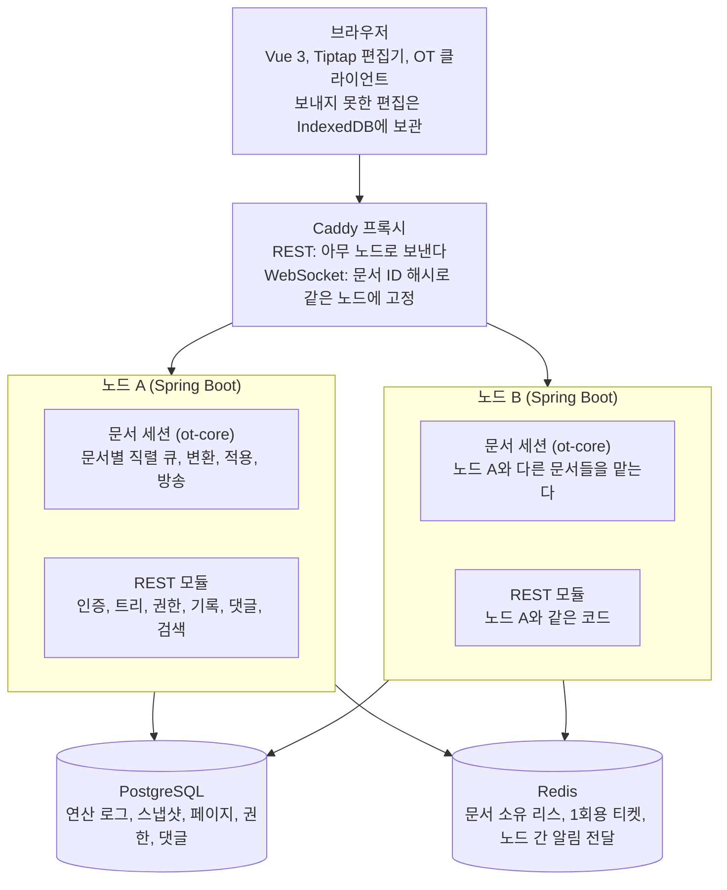

# 5. 시스템 아키텍처

같은 Spring Boot 애플리케이션을 여러 대 띄우고, 한 문서의 편집은 항상 한 노드가 도맡아 처리한다. 이 한 문장이 아키텍처의 핵심이고, 나머지는 이 약속을 지키기 위한 장치다.

두 노드는 같은 코드를 실행하고 둘 다 PostgreSQL과 Redis를 쓴다. 다른 점은 어느 문서의 세션을 메모리에 들고 있느냐뿐이다.

## 5.1 모듈 구성

하나의 배포 단위 안에서 패키지를 모듈로 나누고, 모듈끼리는 공개된 인터페이스와 이벤트로만 주고받는다.

| 모듈 | 책임 | 다른 모듈과의 관계 |
| --- | --- | --- |
| `ot-core` (별도 Gradle 모듈) | 문서 모델, 연산 타입, 적용, 변환, 합성, 역연산 | 아무것도 참조하지 않는다. Spring도 모른다 |
| `identity` | 가입, 로그인, 토큰 발급과 회전, 프로필 | 모든 모듈이 사용자 ID를 받아 쓴다 |
| `workspace` | 워크스페이스, 멤버, 페이지 트리, 휴지통 | 페이지가 만들어지거나 옮겨지면 이벤트를 낸다 |
| `permission` | 페이지 권한 계산, 초대, 공유 링크 | `workspace`의 트리를 읽는다. 권한이 바뀌면 이벤트를 낸다 |
| `collab` | 문서 세션, WebSocket 규약, 연산 로그와 스냅샷, 소유 리스, 프레즌스 | `ot-core`를 쓴다. `permission`에 권한을 묻는다 |
| `history` | 버전 목록, 시점 복원 | `collab`의 로그와 스냅샷을 읽고, 복원 연산을 `collab`에 제출한다 |
| `comment` | 댓글 스레드, 답글, 해결 처리 | 멘션이 생기면 이벤트를 낸다 |
| `notification` | 알림 저장, 실시간 전달(SSE) | 다른 모듈의 이벤트를 듣는다 |
| `search` | 검색용 텍스트 갱신, 검색 API | `collab`의 문서 변경 이벤트를 듣는다 |

모듈 안의 패키지는 팬파라이브와 같은 규칙(`domain`, `app`, `in`, `out`, `config`)을 따른다.

## 5.2 문서 세션과 단일 작성자

문서 세션은 누군가 문서를 열었을 때 메모리에 올라오는 객체다. 현재 문서 내용, 현재 리비전, 접속한 연결 목록, 최근 연산 버퍼를 가진다.

- 한 문서의 연산은 세션의 직렬 실행 큐에서 한 번에 하나씩 처리한다. 락 없이 순서가 정해진다.
- 세션은 마지막 연결이 끊기고 60초가 지나면 스냅샷을 남기고 메모리에서 내린다.
- 문서 세션이 한 노드에만 있으므로 편집 내용을 다른 노드로 방송할 필요가 없다. 같은 문서를 보는 사람은 모두 같은 노드에 붙어 있다.

## 5.3 문서별 노드 고정 라우팅

한 문서를 한 노드가 맡게 하려면 두 단계가 필요하다. 프록시가 빠르게 같은 노드로 보내 주는 단계와, 노드 구성이 바뀌는 순간에도 두 노드가 동시에 쓰지 못하게 막는 단계다.

1. **프록시 해시**: WebSocket 주소 `/ws/docs/{docId}` 의 경로를 해시해서 노드를 고른다. 같은 문서는 같은 노드로 간다.
2. **소유 리스**: 노드는 세션을 올리기 전에 Redis에 `doc:{docId}:owner` 키를 `SET NX PX 6000` 으로 잡는다. 값은 노드 ID와 세대 번호(epoch)다. 2초마다 연장한다.
3. **마지막 방어선**: 연산 로그 테이블의 기본 키가 (문서 ID, 리비전)이다. 리스가 만료된 줄 모르고 계속 쓰려는 노드가 있어도, 같은 리비전을 두 번 넣을 수 없으므로 늦게 쓴 쪽의 INSERT가 실패한다. 실패한 노드는 세션을 버리고 연결을 끊는다.

리스만으로는 충분하지 않다. JVM이 GC나 일시 정지로 멈췄다 깨어나면 자기 리스가 만료된 사실을 모르고 쓸 수 있다. 그래서 DB의 유일 제약을 최종 판정으로 쓴다.

## 5.4 노드가 늘거나 줄 때

| 상황 | 동작 |
| --- | --- |
| 소유 노드가 죽음 | 연결이 끊긴 클라이언트가 재접속한다. 프록시가 살아 있는 노드로 보낸다. 새 노드는 리스가 만료되기를 기다렸다가(최대 6초) 스냅샷과 로그로 세션을 복구한다 |
| 노드를 추가함 | 해시 결과가 바뀐 문서의 새 연결이 새 노드로 온다. 새 노드는 리스를 잡지 못하므로 기존 소유 노드에 양도를 요청한다(Redis pub/sub). 기존 노드는 남은 연산을 커밋하고 스냅샷을 남긴 뒤, 클라이언트에게 종료 코드 4009를 보내고 리스를 풀어 준다 |
| 노드를 계획해서 내림 | 종료 신호를 받으면 새 연결을 받지 않고, 가진 세션을 하나씩 위와 같은 순서로 양도한다 |
| 두 노드가 서로 주인이라고 믿음 | 5.3의 3번으로 한쪽의 커밋이 실패한다. 실패한 쪽에 붙어 있던 클라이언트는 ack를 받지 못한 연산을 재접속 후 다시 보낸다 |

## 5.5 노드 사이를 건너야 하는 것

편집 내용은 노드를 건너지 않지만, 사용자 단위와 워크스페이스 단위의 알림은 건너야 한다. 두 사용자가 서로 다른 노드에 붙어 있을 수 있기 때문이다. 이 세 가지만 Redis pub/sub으로 전달한다.

| 채널 | 내용 | 받는 쪽 |
| --- | --- | --- |
| `ws:{workspaceId}:tree` | 페이지 생성, 이동, 이름 변경, 삭제 | 그 워크스페이스를 보고 있는 사이드바 |
| `user:{userId}:notify` | 멘션, 답글, 초대 알림 | 그 사용자의 알림 연결 |
| `perm:changed` | 권한이 바뀐 페이지 ID | 해당 문서 세션을 가진 노드 |
