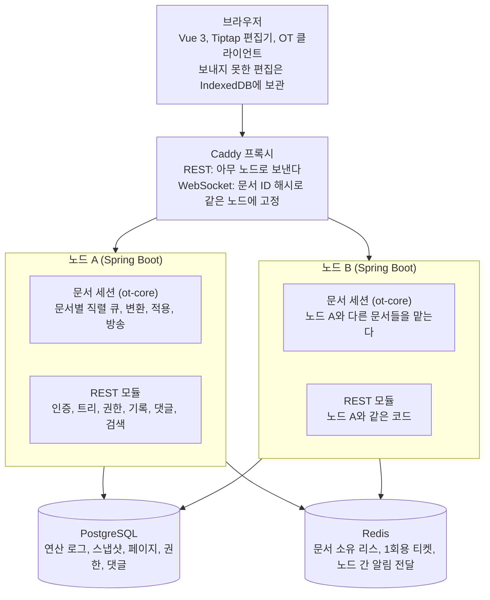

# 5. 시스템 아키텍처

같은 Spring Boot 애플리케이션을 여러 대 띄우고, 한 문서의 편집은 항상 한 노드가 도맡아 처리한다. 이 한 문장이 아키텍처의 핵심이고, 나머지는 이 약속을 지키기 위한 장치다.

두 노드는 같은 코드를 실행하고 둘 다 PostgreSQL과 Redis를 쓴다. 다른 점은 어느 문서의 세션을 메모리에 들고 있느냐뿐이다.

지금 구현은 노드 1대 기준이다. 프록시, 소유 리스, 노드 사이 알림(5.3의 1~2번, 5.4, 5.5)은 로드맵 4단계(다중 노드)에서 만든다. 아래 각 절에 지금 상태를 함께 적는다.

## 5.1 모듈 구성

하나의 배포 단위 안에서 패키지를 모듈로 나누고, 모듈끼리는 공개된 인터페이스(각 모듈의 `app` 과 `domain`)로만 주고받는다. 표의 앞 다섯(`ot-core`, `identity`, `workspace`, `permission`, `collab`)은 만들었고, 뒤 넷(`history`, `comment`, `notification`, `search`)은 5단계에서 만든다.

| 모듈 | 책임 | 다른 모듈과의 관계 |
| --- | --- | --- |
| `ot-core` (별도 Gradle 모듈) | 문서 모델, 연산 타입, 적용, 변환, 합성, 역연산 | 아무것도 참조하지 않는다. Spring도 모른다 |
| `identity` | 가입, 로그인, 토큰 발급과 회전, 프로필 | 모든 모듈이 사용자 ID를 받아 쓴다. 이메일로 사용자를 찾는 `UserDirectory` 를 workspace 와 permission 이 쓴다 |
| `workspace` | 워크스페이스, 멤버, 페이지 트리(만들기, 옮기기, 휴지통), 페이지 제목 | 페이지 접근은 `permission` 에 묻는다. 멤버를 바꾸면 `permission` 의 변경 알림을 부른다. 트리 변경 이벤트(W-5)는 아직 없다 |
| `permission` | 페이지 권한 계산, 페이지 권한 부여와 회수, restricted. 공유 링크는 아직 없다 | `workspace` 의 테이블(pages, workspace_members)을 SQL 로 직접 읽고 자바 코드는 참조하지 않는다. 권한이 바뀌면 `PermissionChangeListener` 포트로 알린다 (9.4, D-17) |
| `collab` | 문서 세션, WebSocket 규약, 연산 로그와 스냅샷, 프레즌스, 지표. 소유 리스는 아직 없다 | `ot-core`를 쓴다. 티켓을 줄 때 `permission` 에 권한을 묻고, 권한 변경 알림을 받아 열린 연결에 적용한다. 루트 블록 글이 바뀌면 `TitleSink` 포트로 `workspace` 의 제목을 고친다(D-21). 사용자 이름은 `identity` 에 묻는다 |
| `history` | 버전 목록, 시점 복원 | `collab`의 로그와 스냅샷을 읽고, 복원 연산을 `collab`에 제출한다 |
| `comment` | 댓글 스레드, 답글, 해결 처리 | 멘션이 생기면 이벤트를 낸다 |
| `notification` | 알림 저장, 실시간 전달(SSE) | 다른 모듈의 이벤트를 듣는다 |
| `search` | 검색용 텍스트 갱신, 검색 API | `collab`의 문서 변경 이벤트를 듣는다 |

모듈 안의 패키지는 팬파라이브와 같은 규칙(`domain`, `app`, `in`, `out`, `config`)을 따른다. 모듈을 잇는 일은 `config` 의 빈 설정에서만 한다.

이 규칙은 ArchUnit 시험(`ModuleBoundaryTest`)이 지킨다. 모듈 사이에 순환이 없고, 다른 모듈은 `app` 과 `domain` 만 쓰며, `domain` 과 `app` 은 `in`, `out`, `config` 를 모르고, `domain` 은 스프링을 모른다 (D-32, [ADR 0018](./adr/0018-module-boundaries-with-archunit.md)).

모듈이 아닌 공통 패키지 `com.copage.web` 은 Origin 허용 목록 설정과, 저장소에 닿지 못한 요청을 503 으로 바꾸는 필터(`StoreUnavailableFilter`, 5.6)를 둔다.

## 5.2 문서 세션과 단일 작성자

문서 세션은 누군가 문서를 열었을 때 메모리에 올라오는 객체다. 현재 문서 내용, 현재 리비전, 접속한 연결 목록, 최근 연산 버퍼를 가진다.

- 한 문서의 연산은 세션의 직렬 실행 큐에서 한 번에 하나씩 처리한다. 락 없이 순서가 정해진다.
- 세션은 마지막 연결이 끊기고 60초가 지나면 스냅샷을 남기고 메모리에서 내린다.
- 세션은 최근 확정 기록을 `history-window`(기본 5,000개)만큼만 든다. 이보다 오래된 기준 리비전으로 보낸 묶음은 nack 하지 않고 연결을 4011 로 닫아, 클라이언트가 resume 으로 다시 맞추게 한다 (7.4, D-06).
- 문서 세션이 한 노드에만 있으므로 편집 내용을 다른 노드로 방송할 필요가 없다. 같은 문서를 보는 사람은 모두 같은 노드에 붙어 있다.

### 5.2.1 커밋 경로

받은 묶음은 바로 처리하지 않고 모아 둔다. 실행 차례가 오면 그때까지 모인 묶음을 차례로 검사, 변환, 적용하고 한 번에 커밋한 뒤 ack 와 remote 를 보낸다 (8.2, [ADR 0005](./adr/0005-commit-before-ack.md)).

1. 순번 검사. 한 연결의 `clientSeq` 는 늘기만 해야 한다. 연결의 첫 묶음에서만 저장소에 그 순번의 확정 여부와 이 클라이언트의 가장 큰 순번을 질의 하나로 묻는다. 이미 확정된 순번이면 처음 리비전으로 ack 를 다시 보낸다. 규칙을 어기면 4008 (7.5).
2. 권한과 입력 검사(9.5, 9.6), 변환과 적용(`ServerDocument`).
3. 모인 행을 `INSERT` 문 하나로 넣는다. 문장 하나는 그 자체로 원자적이라 BEGIN/COMMIT 왕복이 없다. 묶음 수와 상관없이 DB 왕복은 한 번이다. 1,000행이 넘으면 나눠서 한 트랜잭션에 넣는다.
4. 커밋이 실패하거나 묶음을 처리하다 저장소 읽기가 실패하면 세션을 버리고 모든 연결을 4009 로 닫는다. 메모리의 문서가 저장소보다 앞서 있을 수 있기 때문이다. 클라이언트는 재접속해 같은 순번으로 다시 보낸다 (D-33).

예전에는 묶음마다 중복 확인 SELECT 와 INSERT 를 따로 보내 묶음 N 개에 왕복 2N+1 번이었다. DB 응답에 200ms 를 더한 실험에서 처리량이 초당 2.0개에서 8.6개로 늘었다 (PERF-2, D-38, [ADR 0016](./adr/0016-per-connection-seq-and-single-insert.md)).

DB 가 답하지 않으면 JDBC 질의가 끝없이 기다려 세션의 실행 흐름이 막힌다. 그래서 연결에 소켓 시간 한도 10초(`COPAGE_DB_SOCKET_TIMEOUT_SECONDS`)를 두었다. 마이그레이션(Flyway)은 이 한도가 없는 별도 연결로 한다 (D-33).

### 5.2.2 연결과 전송

- 연결마다 전송 대기열과 전송 작업(가상 스레드)을 따로 둔다. 받는 쪽이 느린 연결은 대기열 1MB 또는 10초를 넘으면 4011 로 닫고 WARN 로그를 남긴다. 세션의 실행 흐름은 대기열에 넣는 데까지만 책임진다 (7.7).
- WebSocket 컨테이너(Tomcat)의 글 메시지 버퍼는 메시지 한도와 같은 65,536 글자다. 컨테이너는 이 버퍼를 연결마다 미리 잡는다. 한도의 4배로 두었을 때 힙 1GB 에서 연결 약 930개에 메모리가 넘쳤고, 한도와 같게 두어 연결 2,000개가 돈다 (D-36).

## 5.3 문서별 노드 고정 라우팅

한 문서를 한 노드가 맡게 하려면 두 단계가 필요하다. 프록시가 빠르게 같은 노드로 보내 주는 단계와, 노드 구성이 바뀌는 순간에도 두 노드가 동시에 쓰지 못하게 막는 단계다.

지금은 3번(마지막 방어선)만 있다. 1번과 2번은 4단계에서 만든다. 리스에 펜싱 토큰은 붙이지 않는다. 3번의 기본 키와 리비전이 펜스 역할을 한다 (D-04, [ADR 0013](./adr/0013-primary-key-as-fence.md)).

1. **프록시 해시**: WebSocket 주소 `/ws/docs/{docId}` 의 경로를 해시해서 노드를 고른다. 같은 문서는 같은 노드로 간다.
2. **소유 리스**: 노드는 세션을 올리기 전에 Redis에 `doc:{docId}:owner` 키를 `SET NX PX 6000` 으로 잡는다. 값은 노드 ID와 세대 번호(epoch)다. 2초마다 연장한다. 세대 번호는 쓰기에 싣지 않는다(펜스는 3번, ADR 0013).
3. **마지막 방어선**: 연산 로그 테이블의 기본 키가 (문서 ID, 리비전)이다. 리스가 만료된 줄 모르고 계속 쓰려는 노드가 있어도, 같은 리비전을 두 번 넣을 수 없으므로 늦게 쓴 쪽의 INSERT가 실패한다. 실패한 노드는 세션을 버리고 연결을 끊는다.

리스만으로는 충분하지 않다. JVM이 GC나 일시 정지로 멈췄다 깨어나면 자기 리스가 만료된 사실을 모르고 쓸 수 있다. 그래서 DB의 유일 제약을 최종 판정으로 쓴다.

## 5.4 노드가 늘거나 줄 때

아래 표는 4단계의 설계다. 지금은 노드 한 대를 다시 띄우는 경우만 실험했다. 서버를 `kill -9` 하고 다시 띄우면 클라이언트가 재접속해 끊김부터 첫 ack 까지 p99 4.4~6.3초가 걸렸고 ack 받은 묶음을 잃지 않았다 ([CHAOS.md](./CHAOS.md)).

| 상황 | 동작 |
| --- | --- |
| 소유 노드가 죽음 | 연결이 끊긴 클라이언트가 재접속한다. 프록시가 살아 있는 노드로 보낸다. 새 노드는 리스가 만료되기를 기다렸다가(최대 6초) 스냅샷과 로그로 세션을 복구한다 |
| 노드를 추가함 | 해시 결과가 바뀐 문서의 새 연결이 새 노드로 온다. 새 노드는 리스를 잡지 못하므로 기존 소유 노드에 양도를 요청한다(Redis pub/sub). 기존 노드는 남은 연산을 커밋하고 스냅샷을 남긴 뒤, 클라이언트에게 종료 코드 4009를 보내고 리스를 풀어 준다 |
| 노드를 계획해서 내림 | 종료 신호를 받으면 새 연결을 받지 않고, 가진 세션을 하나씩 위와 같은 순서로 양도한다 |
| 두 노드가 서로 주인이라고 믿음 | 5.3의 3번으로 한쪽의 커밋이 실패한다. 실패한 쪽에 붙어 있던 클라이언트는 ack를 받지 못한 연산을 재접속 후 다시 보낸다 |

## 5.5 노드 사이를 건너야 하는 것

편집 내용은 노드를 건너지 않지만, 사용자 단위와 워크스페이스 단위의 알림은 건너야 한다. 두 사용자가 서로 다른 노드에 붙어 있을 수 있기 때문이다. 이 세 가지만 Redis pub/sub으로 전달한다.

지금은 아무것도 노드를 건너지 않는다. 권한 변경은 프로세스 안의 `PermissionChangeListener` 포트로 같은 노드의 세션에만 알린다(D-17). 트리 변경과 알림은 아직 없다.

| 채널 | 내용 | 받는 쪽 |
| --- | --- | --- |
| `ws:{workspaceId}:tree` | 페이지 생성, 이동, 이름 변경, 삭제 | 그 워크스페이스를 보고 있는 사이드바 |
| `user:{userId}:notify` | 멘션, 답글, 초대 알림 | 그 사용자의 알림 연결 |
| `perm:changed` | 권한이 바뀐 페이지 ID | 해당 문서 세션을 가진 노드 |

## 5.6 저장소 장애와 상태 확인

Redis 에 닿지 못하면 Redis 가 필요한 요청(토큰 검증, 로그인, 재발급, 로그아웃, 티켓, 핸드셰이크)은 503 과 `Retry-After: 5` 로 거절한다(fail-closed). 이미 열린 편집 연결은 Redis 를 쓰지 않으므로 계속 편집된다. PostgreSQL 연결 풀이 시간 안에 연결을 내주지 못할 때도 503 이다. 보안 필터 안에서 나는 저장소 오류까지 잡도록 이 변환은 보안 필터 바깥의 필터(`StoreUnavailableFilter`)가 한다 (9.7, D-03, [ADR 0014](./adr/0014-fail-closed-on-redis-outage.md)).

상태 확인은 관리 포트에 둔다. 생존 검사(재시작 판단)는 `/actuator/health/liveness` 다. 이것은 DB 와 Redis 를 보지 않는다. 묶은 `/actuator/health` 는 Redis 를 보므로 생존 검사에 쓰면 Redis 장애가 모든 노드의 재시작으로 번진다 (13.4, D-25).

## 5.7 지표

Micrometer 지표를 관리 포트(기본 8081, 기본으로 127.0.0.1 에서만)의 `/actuator/prometheus` 로 내보낸다. API 포트의 `/actuator` 는 막는다. 분포는 히스토그램으로 내고, 레이블에는 문서 ID 와 사용자 ID 를 넣지 않는다. 지표 목록은 13.4 에 있다 (D-25).
