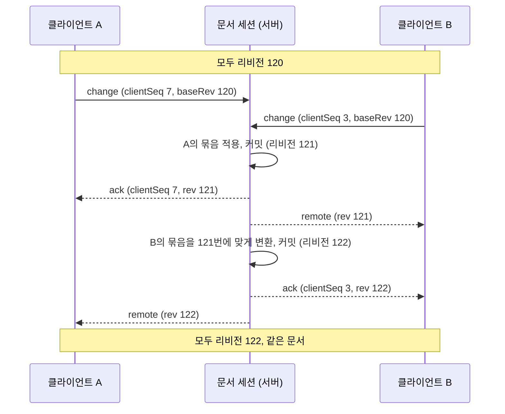

# 7. 실시간 프로토콜

문서 하나에 WebSocket 연결 하나를 쓰고, 메시지는 JSON 텍스트 프레임이다. 클라이언트가 보내는 메시지는 4종, 서버가 보내는 메시지는 7종이다.

## 7.1 연결

```
wss://{host}/ws/docs/{docId}?ticket={1회용 티켓}&v=1
```

브라우저의 WebSocket은 Authorization 헤더를 붙일 수 없다. 그래서 REST로 30초짜리 1회용 티켓을 먼저 받고 주소에 붙인다. 자세한 내용은 9장에 있다. `v` 는 규약 버전이고, 서버가 지원하지 않는 버전이면 종료 코드 4010으로 끊는다.

## 7.2 클라이언트가 보내는 메시지

| 종류 | 필드 | 설명 |
| --- | --- | --- |
| `hello` | `clientId`, `lastRev`, `resume` | 연결 직후 한 번. 처음 여는 문서면 `lastRev` 는 0이고 `resume` 은 false다. 확정 문서를 들고 이어 붙으면 `resume` 이 true다 |
| `change` | `clientSeq`, `baseRev`, `ops` | 편집 묶음. `clientSeq` 는 클라이언트별로 1씩 늘어난다 |
| `presence` | `cursor` | 커서와 선택 영역. 저장하지 않는다 |
| `ping` | 없음 | 20초마다. 서버는 45초 동안 아무것도 없으면 연결을 닫는다(종료 코드 1001) |

```json
{
  "t": "change",
  "clientSeq": 42,
  "baseRev": 120,
  "ops": [
    { "op": "text", "blockId": "b_02", "delta": [{ "retain": 5 }, { "insert": " 초안" }] },
    { "op": "setProps", "blockId": "b_02", "key": "checked", "value": true }
  ]
}
```

## 7.2.1 두 사람이 동시에 보낼 때

아래 그림은 이 흐름을 메시지 순서로 나타낸 것이다.



## 7.3 서버가 보내는 메시지

| 종류 | 필드 | 설명 |
| --- | --- | --- |
| `welcome` | `rev`, `role`, `rebase`, `snapshot` 또는 `ops`, `peers` | `hello` 의 답. 처음 여는 연결(`resume` 이 false)이나 너무 오래된 연결에는 전체 문서를, 이어 붙는 연결에는 `lastRev` 이후의 묶음만 보낸다. `ops` 의 항목은 `remote` 와 같은 필드를 갖는다 |
| `ack` | `clientSeq`, `rev` | 내 묶음이 이 리비전으로 확정됨. DB 커밋 뒤에만 보낸다 |
| `nack` | `clientSeq`, `reason`, `rev`, `code` | 내 묶음이 거부됨. `code` 는 사유 분류(permission, input, empty, rejected). 클라이언트는 rejected 일 때만 다른 블록의 글처럼 그대로 다시 적용할 수 있는 편집을 새 묶음으로 다시 보내고, 나머지는 보관함에 보인다(D-27). `code` 가 없으면(예전 서버) 다시 보내지 않는다 |
| `remote` | `rev`, `userId`, `clientId`, `clientSeq`, `ops` | 다른 연결의 확정된 묶음 (변환이 끝난 형태). 같은 클라이언트가 새 연결로 다시 붙어 있으면 예전 연결로 보낸 묶음도 새 연결에는 `remote` 로 간다 |
| `presence` | `clientId`, `userId`, `name`, `color`, `cursor` 또는 `left` | 다른 사람의 커서, 입장과 퇴장 |
| `role` | `role` | 내 권한이 바뀜(올라가거나 내려감). EDIT 아래(VIEW, COMMENT)면 편집기를 읽기 전용으로 바꾼다. 그 뒤 서버는 그 연결의 묶음을 새 등급으로 검사한다. 권한을 아예 잃으면 이 메시지 대신 4003 으로 닫는다. 문서당 연결 한도로 읽기로 받은 연결은 다시 계산해도 읽기 위로 올리지 않는다 |
| `comment` | `event`, `thread` | 댓글이 달리거나 해결됨. 패널을 갱신한다 |

## 7.4 종료 코드

| 코드 | 뜻 | 클라이언트 동작 |
| --- | --- | --- |
| 4001 | 티켓이 없거나 만료됨 | 티켓을 다시 받아 재접속 |
| 4003 | 권한 없음 또는 권한 회수됨 | 재접속하지 않고 접근 불가 화면 표시 |
| 4008 | 규약 위반 또는 속도 제한 초과 | 재접속하지 않고 오류 표시 |
| 4009 | 문서 세션이 다른 노드로 옮겨감 | 즉시 재접속 |
| 4010 | 규약 버전 불일치 | 새로고침 안내 |
| 4011 | 받는 속도가 느려 보낼 메시지가 너무 쌓임, 또는 보낸 묶음의 baseRev 가 서버의 기록 창(`history-window`, 기본 5000)보다 오래됨 | 재접속해서 다시 동기화 |

## 7.5 재접속과 멱등성

연결이 끊긴 순간 클라이언트는 보낸 묶음이 서버에 들어갔는지 알 수 없다. 이 불확실성을 `(clientId, clientSeq)` 쌍으로 없앤다.

1. 재접속하면 `hello` 에 마지막으로 확인한 리비전과 `resume: true` 를 적어 보낸다. 리비전 0인 새 문서를 열고 편집하다 끊긴 클라이언트도 `lastRev` 가 0이라서, `lastRev` 만으로는 처음 여는 것과 구분할 수 없다.
2. 서버는 그 이후의 연산을 `welcome` 에 담아 보낸다. 그 안에 내 `clientId` 와 `clientSeq` 로 확정된 묶음이 있으면, 끊기기 전에 보낸 묶음이 들어간 것이다. 클라이언트는 그 묶음을 ack 받은 것으로 처리한다.
3. 남은 대기 묶음을 받은 연산에 맞게 변환한 뒤 순서대로 보낸다.
4. 그래도 같은 묶음이 두 번 도착하면 로그 테이블의 `(doc_id, client_id, client_seq)` 유일 제약이 두 번째를 막는다. 서버는 처음 확정된 리비전으로 ack를 다시 보낸다.

`lastRev` 와 현재 리비전의 차이가 5,000을 넘거나 마지막 확인이 7일보다 오래됐으면 서버는 `welcome` 에 `rebase: false` 를 담는다. 클라이언트는 대기 편집을 합치지 않고 복사본 페이지로 보관한다.

## 7.6 프레즌스

커서는 `{ blockId, offset }` 두 개(시작과 끝)로 표현한다. 블록 ID로 가리키므로 다른 블록이 바뀌어도 영향을 받지 않는다.

- 클라이언트는 커서가 움직여도 50ms에 한 번만 보낸다.
- 서버는 저장하지 않고 같은 문서의 다른 연결에 그대로 넘긴다. 각 연결마다 마지막 커서 하나만 기억해 두고 새로 들어온 사람에게 `welcome` 의 `peers` 로 알려 준다.
- 받는 쪽은 이후 들어오는 텍스트 연산에 맞춰 남의 커서 위치를 직접 옮긴다. 커서 메시지가 편집보다 늦게 와도 화면이 어긋나지 않는다.
- 색은 사용자 ID를 해시해 12색 중 하나를 고른다. 같은 사람은 어느 문서에서나 같은 색이다.

메시지 모양은 이렇다. 편집기를 떠나면 `cursor` 가 null 이다. 들어온 연결도 커서 없이 `presence` 로 알린다.

```json
{ "t": "presence", "cursor": { "anchor": { "blockId": "b_02", "offset": 3 }, "head": { "blockId": "b_02", "offset": 7 } } }

{ "t": "presence", "clientId": "tab-1", "userId": "…", "name": "김코", "color": "#e5484d", "cursor": { … } }
{ "t": "presence", "clientId": "tab-1", "userId": "…", "left": true }
```

`welcome.peers` 의 항목은 나간 경우가 아닌 `presence` 와 같은 필드를 갖는다. 이름은 티켓을 발급할 때 담는다.

## 7.7 한도와 보호 장치

| 항목 | 값 | 넘으면 |
| --- | --- | --- |
| `change` 메시지 크기 | 64KB | 4008로 종료. 큰 붙여넣기는 클라이언트가 여러 묶음으로 나눠 보낸다 |
| `change` 빈도 | 연결당 초당 30개 | 4008로 종료 |
| `presence` 빈도 | 연결당 초당 30개 (`max-presence-per-second`) | 넘는 것은 버린다. 연결은 끊지 않는다. 클라이언트는 50ms 마다 많아야 하나를 보낸다 |
| 문서 크기 | 블록 5,000개, 텍스트 2MB | 해당 묶음 nack |
| 문서당 연결 | 100개 | 새 연결을 읽기 전용으로 받음 |
| 연결당 보낼 대기열 | 1MB 또는 10초 | 4011로 종료. 연결마다 전송 대기열과 전송 작업(가상 스레드)을 따로 두고 직접 잰다. Spring의 `ConcurrentWebSocketSessionDecorator` 는 잠금을 얻은 호출 스레드가 직접 쓰므로, 모든 전송이 세션 스레드 하나에서 나가는 이 구조에서는 세션이 막히고 한도도 재지 못한다 |

느린 연결 하나가 문서 세션 전체를 멈추게 두지 않는다. 보내기는 연결마다 따로 쌓고, 세션의 직렬 큐는 쌓는 데까지만 책임진다.

## 7.8 첫 구현에서 정한 것

2단계의 첫 조각(문서 세션과 WebSocket)을 구현하면서 위 표를 고쳤거나 비어 있던 것을 정했다.

| 항목 | 정한 것 | 이유 |
| --- | --- | --- |
| `hello` 의 `resume` | 새로 넣었다 | `lastRev` 0만으로는 처음 여는 연결과 리비전 0에서 이어 붙는 연결을 구분할 수 없다. 이어 붙는 쪽이 전체 문서를 받으면 보낸 묶음이 들어갔는지 알 수 없다 |
| `remote` 와 `welcome.ops` 의 `clientSeq` | 넣었다 | 재접속한 클라이언트가 자기 묶음을 알아보려면 `(clientId, clientSeq)` 가 둘 다 있어야 한다 |
| 오래 떨어진 연결의 판정 | 놓친 첫 묶음이 7일보다 전에 확정되었으면 너무 오래된 것으로 본다 | 서버는 클라이언트가 마지막으로 확인한 시각을 모른다. 그 묶음이 확정된 뒤로 클라이언트는 한 번도 확인하지 못했다 |
| 무응답 연결의 종료 코드 | 1001 | 7.4의 어느 경우에도 맞지 않는다. 클라이언트는 보통의 끊김처럼 재접속한다 |
| 티켓과 버전 오류 | 핸드셰이크는 받아들이고 연결을 연 뒤 4001, 4010으로 닫는다 | 브라우저는 핸드셰이크의 HTTP 상태를 읽을 수 없다. 주소 모양이 틀린 요청만 핸드셰이크에서 400으로 거절한다 |
| 문서 크기 한도 | 블록 수는 삭제 표시된 블록까지 센다. 텍스트는 글자 수(UTF-16 코드 단위) 합계 2,097,152 | 삭제 표시된 블록도 메모리와 저장 공간을 쓴다 |
| 프레즌스 | `hello` 보다 먼저 오면 4008. 읽기 권한도 보낼 수 있다(9.5). 블록 ID 는 100 글자까지, 위치는 0 이상 | 저장하지 않으므로 권한 검사는 하지 않는다 |
| 남의 커서 옮기기 | 받는 쪽은 남의 편집뿐 아니라 자기 편집에도 남의 커서를 옮긴다 | 내가 친 글자 앞에 있던 남의 커서가, 상대가 새 커서를 보내기 전까지 엉뚱한 자리에 보이지 않게 한다 |
